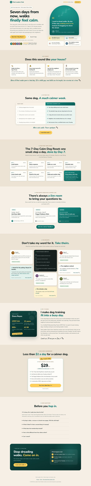
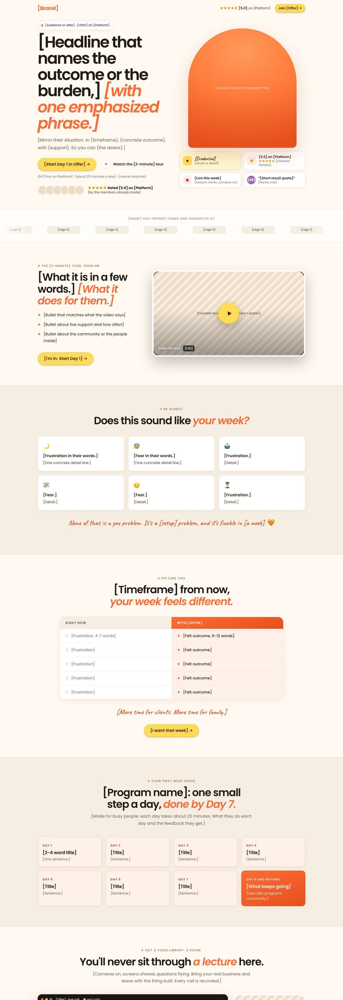

# Proof-First Landing Page

**A Claude skill that builds high-converting landing pages from your real proof.**

Most landing pages fail because they're built on adjectives. This skill flips the order. Claude first hunts down your real testimonials, photos, logos and videos (you probably have far more than you think), then builds a polished, mobile-ready page around them. The page uses a proven 17-section layout.

It came out of building the [Club Jam page](https://jamout.ai/clubjam) and an A/B test version of it for paid ads. Every rule inside is something a real business owner or ads manager asked for during those builds.

## Example

Here's a page the skill built on its own for a made-up dog-training business, Pack Leaders Club. All it had was a short offer description, 8 written testimonials and a few lines of live-call chat. There were no photos or videos, so it used the no-photo versions of the hero, the founder section and the final call to action, and skipped the sections that need logos, videos or screenshots.



## What it does

1. **Asks only what it can't find:** your offer, price, the one link every button points to, and your brand colors.
2. **Hunts for proof first:**
   - testimonials in your folders, spreadsheets and notes
   - screenshots of community posts
   - photos of you (real ones beat AI)
   - logos of organizations you've worked with
   - founder and member videos
   - recordings of live sessions
   - your public platform page and reviews

   Then it shows you an inventory before writing anything.
3. **Picks the angle:** outcome-first (A) or pain-first for busy people (B). Build both for an A/B test.
4. **Preps your media:**
   - clean photo cutouts
   - logos recolored to one ink color
   - trimmed member videos with captions
   - a silent reel of real live calls
   - logged-out screenshots of your platform page
5. **Builds the page** from a fully responsive HTML template you brand with a few color and font settings. No photos of you yet? The hero, the founder section and the final call to action have no-photo versions.
6. **Wires up tracking:** Meta pixel (PageView, ViewContent, Lead on click), GA4 events labeled by variant, and `fbclid`/UTM pass-through to your checkout.
7. **Checks its own work** with a QA checklist, full-page desktop and phone screenshots, and a phone check that scrolls a real phone screen looking for problems.
8. **Hands it to you.** It never publishes without your go-ahead.

## The 17 sections (plus the header)



0. Header
1. Hero (headline, proof row, and your photo with badges *under* it, never on it)
2. Logo strip
3. Video tour
4. Fears and frustrations
5. Right now vs. With [offer]
6. The plan
7. The room (a reel of real live sessions)
8. Events calendar
9. Platform screenshots
10. Wall of love
11. Video testimonials
12. Meet the founder
13. Authority quotes
14. Price
15. FAQ
16. Final call to action
17. Footer and sticky phone bar

Sections you don't have real proof for get deleted, not faked.

## Install

**Claude Code**
```bash
git clone https://github.com/JamoutAi/proof-first-landing-page ~/.claude/skills/proof-first-landing-page
```

**Claude app (claude.ai or desktop)**
1. Download `proof-first-landing-page.skill` from the [latest release](https://github.com/JamoutAi/proof-first-landing-page/releases/latest).
2. Upload it under Customize → Skills. On some versions this is under Settings → Capabilities → Skills.

## Try it

- "Build me a landing page for my coaching program. It's for Facebook ads. My testimonials are in Documents/Testimonials."
- "Make a version B of my sales page that calls out busy small business owners, so we can A/B test it."
- "Here's a page I love. Make mine like this, using my real reviews and photos."

## What you need

- **Required:** Python 3 with Pillow and numpy, and ffmpeg.
- **Optional:**
  - macOS 14+ for one-command photo cutouts (or use `rembg`)
  - `faster-whisper` for captions and transcripts
  - Google Chrome for screenshots
  - Node 22+ for the phone check
- **Hosting:** any static host (Vercel, Netlify, GitHub Pages, Cloudflare Pages).

## What's inside

```
SKILL.md                         the workflow Claude follows
references/page-outline.md       the 17 sections: job, proof, copy formula, pitfalls
references/copy-playbook.md      headline formulas, fears/frustrations/dreams/desires, A to B guide
references/proof-hunt.md         where proof hides, how to inventory it, honesty checks
references/media-recipes.md      cutouts, logos, video trims, captions, reels, screenshots
references/tracking-and-testing.md  pixel, analytics, SEO, A/B test setup, safe publishing
references/qa-checklist.md       everything to check before showing the owner
assets/landing-template.html     the page template (brand tokens, no-photo fallbacks, PAGE config)
scripts/                         contact sheets, cutouts, logo recolor, captions, session reel, screenshots, phone check
```

## Rules baked in (learned the hard way)

- **Find the proof before writing.** A thin first draft gets the reaction "I have SO many testimonials."
- **Nothing floats over your hero photo.** Badges go underneath, because floating cards are distracting.
- **Real photos for proof.** AI-generated images look staged next to real member screenshots.
- **Quotes stay word for word.** No invented results. Member counts round down, and ratings stay exact.
- **Check every video for outdated offers** (old trials, old prices) before it goes on the page.
- **One destination for every button.** The text changes by section.

## Credits

Made by [Jam Anderson](https://jamout.ai/about), Official Claude Partner and founder of Jam AI. Jam teaches everyday business owners to use AI for their marketing.

Want to learn to build things like this with Claude, with live help every week? [Join Club Jam on Skool](https://jamout.ai/clubjam). 🧡

## License

MIT. Use it, change it, build great pages with it.
